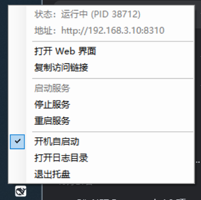

# dsh-web-tray

一个非常简单的 Windows PowerShell 脚本，零依赖、运行无负担：在系统托盘后台托管 `dsh --profile web`，并用 Microsoft Edge `--app` 窗口承载 Web 界面。



## 为什么不用官方桌面版

DeepSeek Harness 官方桌面版基于 Electron，内存与进程开销大，且只能本机使用、无法局域网访问。直接托管 `dsh --profile web` 并复用系统自带的 Edge App 窗口，既省去独立 Electron 开销，又能绑定局域网 IP 供其他设备直接访问。

## 环境要求

- Windows 10 / 11（自带 Windows PowerShell 5.1 与 Microsoft Edge）
- `dsh` 已加入系统 `PATH`（`npm install -g @deepseek-ai/dsh`）

## 安装

从 [GitHub Releases](https://github.com/juexe/dsh-web-tray/releases) 下载 `dsh-web-tray-<版本>-setup.exe` 运行。安装到当前用户的 `%LOCALAPPDATA%\Programs\dsh-web-tray`，无需管理员权限。

winget 包收录后也可以直接安装：

```powershell
winget install --id Juexe.DshWebTray --exact
```

安装后从开始菜单启动。卸载会先停止托盘，再删除程序文件；`data/` 中的配置、日志与 Edge 配置会保留。如果启动时 `PATH` 中没有 `dsh`，托盘会保持运行并提示安装，安装后可从菜单重新启动服务。

## 从源码运行

直接双击 `dsh-web-tray.cmd` 即可启动（或在终端运行 `.\dsh-web-tray.cmd`）。

首次运行会自动生成 `data/config.json`，修改后重启托盘生效：

```json
{
  "bindHost": "127.0.0.1",
  "port": 8310,
  "openWindow": true,
  "window": {
    "left": 50,
    "top": 0,
    "width": 1813,
    "height": 1158
  }
}
```

- `bindHost`：监听地址。如需局域网访问，改为本机局域网 IP（如 `192.168.x.x`）。
- `port`：监听端口（被外部进程占用时直接报错，不强杀外部进程）。
- `openWindow`：启动托盘时是否自动弹出窗口。
- `window`：Edge 窗口位置与尺寸（DIP 坐标）。

也支持通过命令行参数临时覆盖单次启动：

```powershell
.\dsh-web-tray.cmd -BindHost 192.168.3.10 -Port 8310
.\dsh-web-tray.cmd -NoWindow
```

停止正在运行的托盘：

```powershell
.\dsh-web-tray.cmd -Stop
```

## 托盘操作

- **左键单击托盘图标**：打开或聚焦 Web 窗口（使用 `data/edge-profile` 独立配置并开启 `--disable-sync`，不污染日常浏览器）。
- **右键菜单**：打开 Web 界面、复制带 token 的访问链接、启动/停止/重启服务、开机自启动、打开数据目录、退出托盘。

## 开发与打包

安装包由 Inno Setup 6 构建，版本号统一来自仓库根目录的 `VERSION` 文件：

```powershell
winget install --id JRSoftware.InnoSetup --exact --source winget
.\packaging\build.ps1
```

产物和 SHA256 校验文件输出到 `dist/`。winget 清单位于 `packaging/winget/`，提交与版本更新步骤见 `packaging/README.md`。

## 测试

```powershell
powershell -NoProfile -File tests/smoke.ps1
```

## License

MIT
